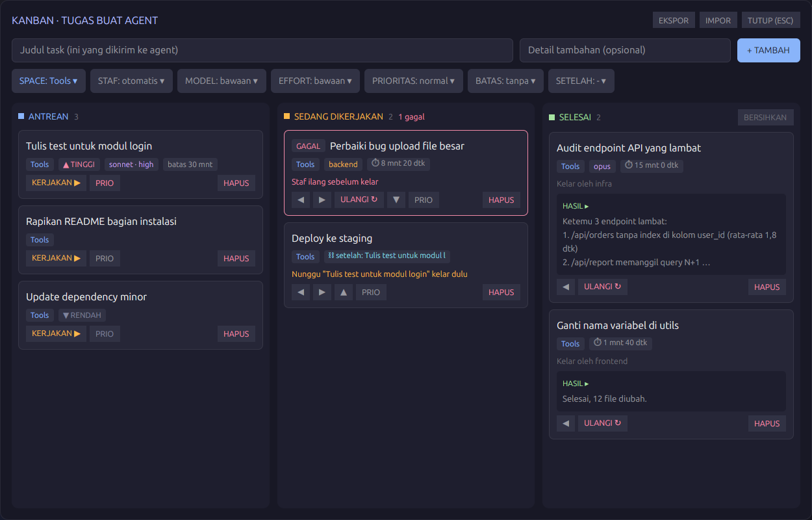
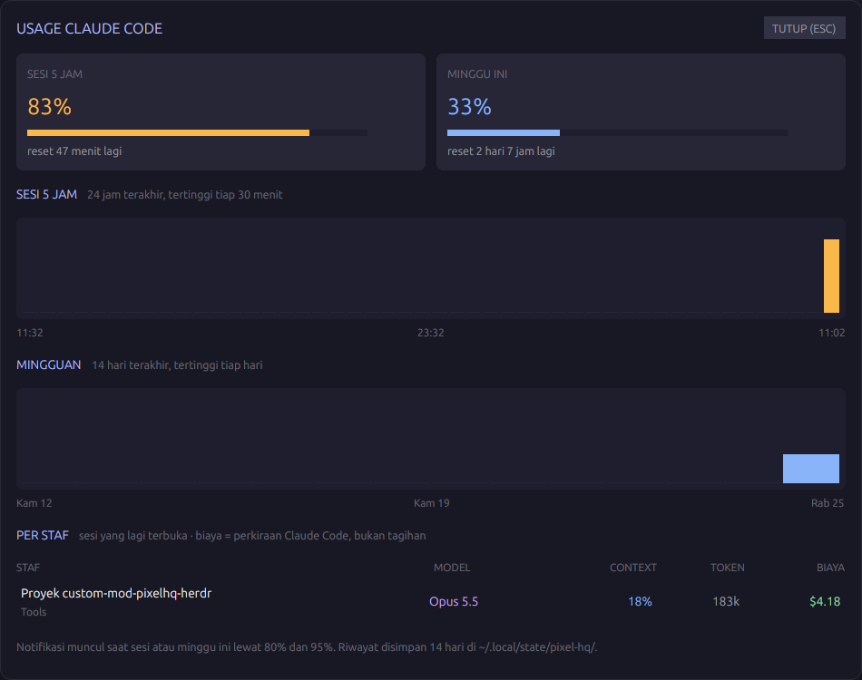
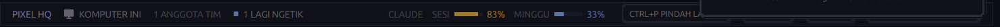

# custom-mod-pixelhq-herdr

[](https://github.com/Dzuuul/custom-mod-pixelhq-herdr/actions/workflows/tes.yml)

Versi custom dari layout **[Pixel HQ](https://github.com/bnhan2710/pixel-hq)** untuk **Herdr**:
antarmuka berbahasa Indonesia santai, papan kanban yang bisa menyuruh agent kerja, dan pemantau usage Claude Code.

> Dasarnya Pixel HQ commit `1e09cc1` (MIT). Lihat [NOTICE.md](NOTICE.md).



## Apa yang beda dari Pixel HQ asli

| Perubahan | Di mana |
| --- | --- |
| **Bahasa Indonesia santai/gaul** di semua tampilan: status bar, sidebar, panel, form rekrut, editor figur, lembar hotkey, notifikasi updater, nama jabatan | semua mod `company-*` |
| **Nama staf acak dan unik**: tiap terminal baru (staf baru / sesi baru) dapat nama orang, binatang, atau peliharaan yang belum dipakai staf lain | `company-agents/names.js`, `company-pane` |
| **Pencarian staf dua bahasa**: `ngetik`, `santai`, `kelar`, `nunggu` dan padanan Inggrisnya sama-sama jalan | `company-agents` |
| **Papan Kanban** (dialog 3 kolom + panel kanan) dan mesin yang mengirim task ke staf, dengan **EDIT**, **STOP**, dan **LIHAT** di kartu | `company-kanban`, `company-status/kanban.js`, `layouts/pixel-hq.json` |
| Kanban yang **tahu kapan berhenti**: task ditahan kalau usage Claude hampir habis, kartu **PERLU JAWABAN** kalau staf nanya balik, batas waktu yang bisa menghentikan agent, dan biaya/token per task | `company-status/kanban.js`, `company-kanban` |
| Kanban yang **bisa ditinggal** (2.3): **CEK** otomatis setelah agent berhenti (gagal = agent disuruh benerin), **jawab dari kartu**, **worktree** per task dan ringkasan **diff**, **bawa hasil** task sebelumnya, **batas biaya**, **jadwal** (jam mulai, tiap hari, hari kerja) dan **template** | `company-status/kanban.js`, `company-kanban` |
| **Notifikasi ke HP** (ntfy, Discord, Slack, Telegram) waktu task kelar, nanya balik, atau gagal, kalau jendela Herdr lagi gak kamu lihat | `company-status/kanban.js`, `company-kanban` |
| **Rekap kanban**: task kelar/gagal per hari, per staf, dan per model, plus biaya dan durasi | `company-usage`, `company-status/kanban.js` |
| HASIL buat **agent selain Claude** (dari layar terminal), space di **mesin lain** (`hc machine`), dan **judul jendela** yang ikut isi kanban | `company-status` |
| **`pixel-hq-task`**: tambah task ke kanban dari terminal, skrip, atau agent | `company-kanban/pixel-hq-task.*`, `install.sh`/`install.ps1` |
| **Hotkey** `Ctrl+Shift+J` (Kanban) dan `Ctrl+Shift+M` (Usage), tampil juga di lembar HOTKEY | `install.sh`/`install.ps1` (`keys.json`), `company-hotkeys` |
| Tombol **KANBAN** di bar atas dan status bar (dengan jumlah task jalan, nanya balik, ditahan, dan gagal) | `company-tabs`, `company-status` |
| **Usage Claude Code**: chip `SESI`/`MINGGU` di status bar, notifikasi (bawaan 80% dan 95%, bisa diganti), dialog riwayat dan pemakaian per staf | `company-status`, `company-usage`, `company-agents/claude-statusline.sh` |
| **Updater dari repo ini**, bukan dari Pixel HQ asli, jadi tombol update gak menimpa perubahan lokal | `company-agents/updater.js` |
| **`uninstall.sh`** untuk mencopot atau memulihkan dari backup | `uninstall.sh` |
| **MusicBox dihapus** (tombol, hotkey, mod, area radio di rak) | `company-status`, `company-agents`, `company-hotkeys` |
| **Installer dan uninstaller Windows** (PowerShell, tanpa Python/`sh`) + statusLine & hook aktivitas versi PowerShell | `install.cmd`, `install.ps1`, `uninstall.cmd`, `uninstall.ps1`, `company-agents/*.ps1` |
| **Windows + Claude Code di WSL**: usage, riwayat, dan hasil kerja kanban dibaca juga dari home WSL (yang terbaru dipakai), cuma dari distro yang lagi jalan, jadi WSL gak ikut dinyalakan; stasiun bernama `~` memakai nama folder kerja agent | `company-status/state.js`, `company-usage/state.js`, `company-spaces`, label `agent.cwd` |

Yang sengaja tetap bahasa Inggris: perintah yang dikirim ke AI dari tombol "Rapikan pakai AI" di editor figur.

## Syarat

- [Herdr](https://herdr.dev) terpasang dan **sudah pernah dijalankan** (supaya `~/.config/herdr-app` ada).
- Linux/macOS: `python3` dan `sh`. Windows: cukup Windows PowerShell 5.1 (bawaan Windows 10/11),
  **tanpa** Python, `sh`, atau Git Bash.
- Opsional: Claude Code (`~/.claude`) untuk usage, hasil kerja di kanban, dan animasi aktivitas.

## Pasang (Linux/macOS)

```sh
git clone https://github.com/Dzuuul/custom-mod-pixelhq-herdr.git
cd custom-mod-pixelhq-herdr
sh install.sh
herdr-app do layout.switch '{"name":"pixel-hq"}'
herdr-app status        # "errors" harus kosong
```

`install.sh` melakukan ini, berurutan:

1. **Backup** kondisi lama ke `~/backups/herdr/sebelum-custom-pixelhq-<waktu>.tar.gz`
   (isi `~/.config/herdr-app` dan `~/.claude/settings.json`). Kalau backup gagal, pemasangan dibatalkan.
2. Menyalin `layouts/pixel-hq.json`, `themes/pixel-hq.json`, dan semua mod `company-*`
   ke `~/.config/herdr-app`. Mod `company-*` yang sudah ada **ditimpa**, file lain tidak disentuh.
   Lalu menambahkan hotkey Kanban (`ctrl-shift-j`) dan Usage (`ctrl-shift-m`) ke `keys.json`, di bagian
   `layout:pixel-hq` (jadi cuma aktif di layout ini). Tombol yang sudah kamu pakai buat hal lain gak ditimpa,
   cuma dilewati dengan pesan. Catatan: Herdr berhenti menambahkan shortcut bawaan baru ke `keys.json`
   yang pernah diubah; ini juga berlaku kalau kamu sendiri pernah mengubahnya.
   Terakhir, memasang perintah terminal `pixel-hq-task` ke `~/.local/bin` (file dengan nama sama yang bukan
   punya Pixel HQ gak ditimpa).
3. Kalau `~/.claude` ada:
   - menyalin `pixel-hq-statusline.sh` dan menambahkan `statusLine` ke `settings.json`
     **hanya kalau belum ada** (punyamu tidak ditimpa),
   - memasang hook aktivitas lewat `claude-activity.py install` (hook lain dipertahankan).

Folder konfigurasi lain bisa dipakai lewat `HERDR_APP_HOME=/path sh install.sh`.
Setelah `git pull`, jalankan `sh install.sh` lagi untuk memasang versi terbaru.

## Pasang (Windows)

Clone repo ini di Windows, lalu **klik dua kali `install.cmd`**. Atau dari terminal (cmd/PowerShell):

```powershell
git clone https://github.com/Dzuuul/custom-mod-pixelhq-herdr.git
cd custom-mod-pixelhq-herdr
.\install.cmd
herdr-app do layout.switch --name pixel-hq
herdr-app status        # "errors" harus kosong
```

`install.cmd` hanya menjalankan `powershell -NoProfile -ExecutionPolicy Bypass -File install.ps1`,
jadi ExecutionPolicy komputer tidak perlu diubah. Langkahnya sama dengan versi Linux:

1. **Backup** ke `%USERPROFILE%\backups\herdr\sebelum-custom-pixelhq-<waktu>.zip`
   (isi `%USERPROFILE%\.config\herdr-app` dan `.claude\settings.json`; socket `herdr-app.sock` dilewati).
2. Menyalin layout, tema, dan mod `company-*` ke `%USERPROFILE%\.config\herdr-app`
   (pakai `robocopy /MIR`, jadi isi mod disamakan persis dengan repo; file lain tidak disentuh).
3. Kalau `%USERPROFILE%\.claude` ada:
   - menyalin `claude-statusline.ps1` ke `.claude\pixel-hq-statusline.ps1` dan memasang `statusLine`
     kalau belum ada, atau kalau yang terpasang versi Pixel HQ lama (`sh ...pixel-hq-statusline.sh`, yang
     butuh Python). StatusLine milikmu sendiri tidak ditimpa,
   - memasang hook aktivitas lewat `claude-activity.ps1 install` (hook lain dipertahankan,
     `settings.json` di-backup ke `settings.json.pixel-hq.bak`).
4. Menambahkan hotkey Kanban dan Usage ke `keys.json`, sama seperti di Linux.
5. Memasang perintah `pixel-hq-task` ke `%LOCALAPPDATA%\Microsoft\WindowsApps` (folder itu biasanya sudah ada di PATH).
   Kalau gak ada di PATH, installer menampilkan jalur lengkap `pixel-hq-task.cmd` buat dipakai langsung.

Folder konfigurasi lain: `$env:HERDR_APP_HOME = "D:\herdr"; .\install.cmd`.

Bedanya dengan Linux, semuanya versi PowerShell (`mods/company-agents/*.ps1`), bukan `sh` + Python:

- **statusLine** (`claude-statusline.ps1`): isi dan label sama dengan `claude-statusline.sh`, termasuk
  riwayat usage (`claude-usage-history.json`) serta token dan biaya per sesi.
  Mod `company-agents` di Windows juga memakai skrip ini saat Herdr start, dengan perintah yang sama persis,
  jadi installer dan mod tidak saling timpa.
- **Hook aktivitas** (`claude-activity.ps1`): matcher-nya `Bash|PowerShell` (Claude Code di Windows punya
  dua tool shell). PowerShell butuh beberapa ratus ms untuk start, jadi hook yang jalan di sekitar setiap
  perintah, subagent, dan giliran dipasang **`"async": true`** (Claude Code tidak menunggunya);
  hanya `SessionStart`/`SessionEnd` yang sinkron. Hook `Stop` juga menyimpan pesan terakhir agent buat kartu kanban.
  Hook `Stop` yang dipasang versi lama tetap dikenali, jadi gak perlu pasang ulang hook buat fitur ini.
- Perintahnya `powershell -NoProfile -ExecutionPolicy Bypass -File "C:/..."`, jalan baik saat Claude Code
  memakai Git Bash maupun PowerShell untuk hook.

### Dipasang ke Claude Code, bukan cuma Herdr

Dua hal ini mengubah `~/.claude/settings.json`:

- `statusLine`: menulis usage ke `~/.local/state/pixel-hq/claude-usage.json` (plus riwayatnya di
  `claude-usage-history.json`), dan label terminal Herdr (context, model, effort, token, biaya).
- hook aktivitas: label terminal untuk animasi, dan pesan terakhir agent di akhir tiap giliran
  (`~/.local/state/pixel-hq/last/<terminal>.json`) buat ditampilkan di kartu kanban.

Backup `settings.json` ada di langkah 1. `sh uninstall.sh` (Windows: `uninstall.cmd`) mencabut keduanya (lihat bawah).

## Cara pakai Kanban

Buka lewat tombol **KANBAN** (bar atas = panel kanan, status bar = dialog lebar), `Ctrl+Shift+J`, atau palet perintah "Papan kanban".

1. Isi judul (dan detail), lalu pilih:
   - **SPACE**: sesi/space yang mengerjakan,
   - **STAF**: sesi terminal di space itu (pakai nama stafnya, mis. `Luna`), atau `otomatis`,
   - **MODEL** (opus/sonnet/haiku/fable) dan **EFFORT** (low…max), atau `bawaan`,
   - **PRIORITAS**: `tinggi` dikirim duluan kalau beberapa task nunggu staf yang sama,
   - **BATAS**: batas waktu kerja agent (10/30/60/120 menit), lalu **LEWAT BATAS**: `ingatkan` (notifikasi + kartu
     ditandai) atau `hentikan` (agent disuruh berhenti, kartu ditandai DIHENTIKAN). Waktu nunggu jawabanmu gak dihitung,
   - **SETELAH**: task ini baru dikirim setelah task yang dipilih masuk Selesai,
   - **OPSI LAIN ▾**: CEK, BIAYA MAKS, BAWA HASIL, WORKTREE, JAM dan ULANG, dan TEMPLATE (lihat bawah).
2. **+ TAMBAH** → masuk kolom **Antrean**.
3. **KERJAKAN ▶** → pindah ke **Sedang dikerjakan**. Mesin (jalan tiap 3 detik selama Herdr terbuka):
   - mengirim `/model` dan `/effort` bila dipilih (hanya ke sesi Claude Code), lalu task-nya, lewat `hc send`,
   - menunggu kalau stafnya sibuk atau task yang ditunggu belum kelar,
   - membuka tab Claude baru bila space itu belum punya agent (MODEL dan EFFORT ikut lewat `--model`/`--effort`),
   - memindahkan kartu ke **Selesai** saat staf kembali nganggur, dengan notifikasi, durasi, dan biayanya,
   - **mengembalikan model/effort** staf ke setelan sebelum task (lewat `/model` dan `/effort` lagi),
   - menaruh **HASIL** (pesan terakhir agent) di kartu. Klik kotaknya untuk melihat lengkap,
   - mencatat **biaya dan token** task itu (mis. `$0.42 · 12k token`), dari selisih angka statusline staf
     sebelum dan sesudah task.

Di tiap kartu: **▲ ▼** mengubah urutan (di antara kartu dengan prioritas sama), **PRIO** mengganti prioritas,
**ULANGI ↻** mengirim ulang task yang gagal atau sudah selesai.

- **EDIT** (kartu di Antrean, atau yang gagal/dihentikan) mengisi form atas dengan isi task itu. Ubah judul, detail,
  atau pilihannya, lalu **SIMPAN ✓** (atau **BATAL**). Di pilihan SETELAH, task yang nunggu task ini gak muncul,
  jadi gak bisa bikin dua task saling nunggu. Task yang keburu jalan waktu kamu edit gak diubah.
- **STOP ■** (kartu yang lagi dikerjakan) menyuruh agent berhenti, sama kayak menekan Esc di terminalnya.
  Kartunya ditandai **DIHENTIKAN** (oranye, gak dihitung sebagai gagal), model/effort staf dikembalikan,
  dan **ULANGI** mengirimnya lagi.
- **LIHAT ▸** membuka terminal staf yang pegang task itu (dialog kanban ditutup biar gak nutupin).
- **DIFF ▸** (task yang kelar atau gagal, di repo git) membuka tab baru berisi perubahan file sejak task dikirim.
  Kartunya juga menampilkan ringkasannya, mis. `± 3 file +120 −14 · 1 file baru`.

**PERLU JAWABAN** (pink): kalau baris terakhir balasan agent berupa pertanyaan ("Mau pakai A atau B?"), kartunya
gak dipindah ke Selesai. Kartu tetap di "Sedang dikerjakan", pertanyaannya tampil di kartu, dan muncul notifikasi.
**Jawab langsung dari kartu**: ketik di kotak jawabannya lalu Enter (atau **KIRIM ▸**), sama kayak ngetik di terminalnya.
Kalau pertanyaannya punya pilihan, tombolnya muncul di atas kotak itu: pilihan bernomor ("1. … 2. …"), "A atau B?",
atau **Ya, lanjut** / **Gak usah** buat pertanyaan ya/gak. Buat jawaban panjang, **TERMINAL ▸** membuka terminalnya.
Setelah kamu jawab, mesin lanjut memantau seperti biasa. Kalau pertanyaannya cuma basa-basi ("Ada lagi yang bisa
dibantu?"), klik **KELAR ✓**. Selama nunggu jawaban, task yang menunggu task ini ikut nunggu, staf itu gak dikasih
task lain, dan model/effort-nya belum dikembalikan.

**DITAHAN** (hijau toska): kalau usage Claude sesi 5 jam atau minggu ini sudah **95%** ke atas, task yang belum terkirim
ke staf Claude ditunda, dengan catatan kapan usage-nya reset (mis. "dikirim setelah reset 14:00"). Task dikirim sendiri
setelah reset. **KIRIM AJA** mengirimnya sekarang juga. Staf selain Claude Code gak ditahan. Butuh statusLine Pixel HQ
(sumber angka usage-nya).

**Task gagal** ditandai merah (kartu tetap di kolom "Sedang dikerjakan") kalau: pengiriman gagal 5 kali,
stafnya hilang sebelum kelar, tab agent baru gak muncul dalam 1 menit, balasan agent berupa error
(`API Error`, batas usage), atau CEK-nya masih gagal setelah 3 kali dibenerin. Notifikasi muncul dan jumlahnya tampil
di tombol KANBAN.

### OPSI LAIN

- **CEK** (mis. `npm test`, `cargo test`, `make lint`): perintah yang dijalankan di folder agent setelah dia berhenti.
  Kartunya ditandai **NGECEK** selama cek jalan. Lolos (kode keluar 0) = pindah ke Selesai dengan tanda `cek · lolos`.
  Gagal = 60 baris terakhir output-nya dikirim balik ke agent ("Cek otomatis `npm test` gagal… perbaiki"), lalu dicek lagi
  waktu dia berhenti. Sampai **3 kali** dibenerin; setelah itu kartunya gagal. **OUTPUT CEK** di kartu menampilkan
  output terakhirnya. Cek jalan di belakang (sampai 10 menit), jadi task lain tetap jalan. Kalau kamu nyuruh agent
  sesuatu waktu cek jalan, ceknya dibatalin dan diulang waktu dia berhenti lagi.
  Linux/macOS: lewat `sh -c`. Windows: lewat PowerShell, atau lewat WSL kalau folder agent-nya jalur WSL.
- **BIAYA MAKS** ($0.50/$1/$2/$5): sama kayak BATAS, tapi dari biaya task. **LEWAT BATAS** berlaku buat keduanya:
  `ingatkan` atau `hentikan`.
- **BAWA HASIL** (muncul kalau SETELAH dipilih): HASIL task yang ditunggu ditempel di bawah task ini waktu dikirim.
  Contoh: "Bikin rencana migrasi" lalu "Kerjakan rencana ini" dengan BAWA HASIL.
- **WORKTREE**: task dikerjain agent Claude baru di git worktree dan branch sendiri, jadi beberapa task bisa jalan bareng
  di repo yang sama tanpa saling timpa. Branch-nya `kanban/<judul>-<id>`, foldernya `<repo>/../.worktrees/<repo>-kanban-…`
  (sama dengan worktree crew Pixel HQ). Folder space-nya harus repo git. Kartunya menampilkan branch-nya; **FOLDER ▸**
  membuka terminal di sana. Gabungkan branch-nya sendiri kalau udah oke. ULANGI memakai worktree yang sama; HAPUS gak
  menghapus worktree atau branch-nya.
- **JAM** (mis. `22:00`) dan **ULANG**: `sekali` = task nunggu di Antrean dengan tanda `⏰ mulai …`, lalu jalan sendiri
  di jam itu. `tiap hari` / `hari kerja` (Sen–Jum) = jadi **JADWAL**: tiap jam itu salinannya dijalankan, jadwalnya
  tetap di Antrean. **JALANKAN ▶** di kartu jadwal menjalankan salinannya sekarang juga. Kalau Herdr lagi tutup waktu
  jamnya tiba, task jalan begitu Herdr dibuka (sekali aja). KERJAKAN ▶ di task berjadwal sekali = jalan sekarang,
  jadwalnya batal.
- **TEMPLATE**: **+ JADI TEMPLATE** menyimpan isian form (namanya = judul); **TEMPLATE ▾** mengisi form dari template
  berikutnya; **HAPUS TEMPLATE** menghapus yang lagi dipilih. Disimpan di `~/.config/herdr-app/pixel-hq-kanban-templates.json`.

Model, effort, CEK, BIAYA, dan WORKTREE tetap terpilih buat task berikutnya; JAM, ULANG, dan BAWA HASIL cuma buat
task yang barusan ditambah.

### Notifikasi ke HP

Tombol **HP** di atas papan membuka pengaturannya. Isi alamatnya, lalu **SIMPAN** dan **TES**:

- **ntfy** (paling gampang): pasang app ntfy di HP, langganan topik yang susah ditebak, lalu isi
  `https://ntfy.sh/<topik>` (atau server ntfy sendiri).
- **Discord** / **Slack**: URL webhook channel-nya.
- **Telegram**: `https://api.telegram.org/bot<TOKEN>/sendMessage?chat_id=<ID>`.

Yang dikirim: task kelar, nanya balik, gagal, dihentikan, dan lewat batas (judul task ikut terkirim ke layanan itu).
Bawaannya cuma dikirim kalau jendela Herdr lagi gak kamu lihat; **KIRIM: selalu** mengirim tiap saat. Dikirim lewat
`curl` (ada di Linux, macOS, dan Windows 10 ke atas). **MATIKAN** menghapus alamatnya.

### Rekap

**REKAP** di atas papan (atau tab **REKAP KANBAN** di dialog Usage) menampilkan task yang kelar dan gagal per hari,
biaya, rata-rata durasi, CEK yang lolos, dan tabel per staf dan per model, buat 7, 30, atau 90 hari. Datanya dicatat
mesin kanban tiap task kelar, gagal, atau dihentikan, di `~/.config/herdr-app/pixel-hq-kanban-history.json` (90 hari).
**BERSIHKAN** di kolom Selesai gak menghapus rekap.

**EKSPOR** menyimpan papan ke `pixel-hq-kanban-<waktu>.json` (bisa diimpor lagi) dan `.md` (buat dibaca)
di folder yang kamu pilih. **IMPOR** mengambil task dari file JSON ekspor: task yang sudah ada gak didobel,
space dicocokkan lewat nama, dan task yang tadinya jalan masuk Antrean dulu.

Data task ada di `~/.config/herdr-app/pixel-hq-kanban.json` (per komputer, tidak ikut repo).

### Tambah task dari terminal: `pixel-hq-task`

```sh
pixel-hq-task "Perbaiki tes yang gagal"                    # masuk Antrean
pixel-hq-task -k "Update dependensi" -d "jangan major"     # langsung Sedang dikerjakan
pixel-hq-task -k -s api -m sonnet -e high -p tinggi --batas 30 --hentikan "Review PR #12"
git diff | pixel-hq-task -k -d - "Review perubahan ini"    # detail dari stdin
pixel-hq-task -k --cek "npm test" --biaya 2 --hentikan "Perbaiki bug login"   # CEK dan batas biaya
pixel-hq-task -k --worktree "Fitur export CSV"             # worktree dan branch sendiri
pixel-hq-task --jam 09:00 --ulang kerja "Cek dependensi"   # jadwal tiap hari kerja jam 09:00
pixel-hq-task -h                                           # semua pilihan
```

Tanpa `-s`, task masuk ke space terminal Herdr tempat perintah itu dijalankan, atau ke space yang lagi dibuka kalau
dijalankan di luar Herdr. Agent di Herdr juga bisa memakainya buat menitipkan pekerjaan lanjutan ke papan.
Perintahnya cuma menulis `pixel-hq-kanban-inbox.json`; mesin kanban mengambilnya dalam beberapa detik (atau waktu
Herdr dibuka lagi). Kartunya bertanda `⌨ terminal`. Task yang kamu hapus dari papan gak muncul lagi.

Windows (`pixel-hq-task.ps1`, pilihannya gaya PowerShell, boleh disingkat huruf pertamanya):

```powershell
pixel-hq-task "Perbaiki tes yang gagal"
pixel-hq-task -Kerjakan -Space api -Model sonnet -Batas 30 -Hentikan "Review PR #12"
git diff | pixel-hq-task -K -Stdin "Review perubahan ini"
pixel-hq-task -Kerjakan -Cek "npm test" -Biaya 2 -Worktree "Perbaiki bug login"
pixel-hq-task -Jam 09:00 -Ulang kerja "Cek dependensi"
```

Yang update lewat tombol update (bukan `install.sh`) belum punya perintah `pixel-hq-task` di PATH: jalankan installer
sekali lagi, atau panggil langsung `python3 ~/.config/herdr-app/mods/company-kanban/pixel-hq-task.py`.

**Catatan:**
- Model dikembalikan lewat alias (`opus`, `sonnet`, …) dari nama model yang dilaporkan statusline.
  Kalau sebelumnya kamu pakai versi model tertentu, hasilnya bisa versi terbaru dari keluarga yang sama.
- Hasil kerja butuh hook aktivitas terpasang (otomatis lewat `install.sh`/`install.cmd`) dan Claude Code.
  Begitu juga PERLU JAWABAN, yang membaca hasil kerja itu. Agent selain Claude Code (Codex, dll.), atau Claude yang
  hook-nya gak kebaca dalam 20 detik, dapat HASIL dari baris terakhir layar terminalnya (`hc read`), bertanda
  "dari layar terminal". HASIL dari layar gak dipakai buat PERLU JAWABAN, karena isinya bisa kecampur prompt.
- **Space di mesin lain** (`hc machine`, mis. VPS): task dikirim dan dipantau seperti biasa. HASIL dan PERLU JAWABAN
  dibaca dari `~/.local/state/pixel-hq/last/` di mesin itu (pasang Pixel HQ di sana juga biar hook-nya ada), kalau gak ada
  dari layar terminalnya. CEK dan DIFF juga jalan di mesin itu. Angka usage (DITAHAN) tetap dari komputer ini.
- DIFF dihitung dari `git stash create` waktu task dikirim: perubahan yang belum di-commit sebelum task gak ikut terhitung,
  dan gak ada yang diubah di repo (gak ada stash, commit, atau index yang berubah). File baru dihitung terpisah.
- Biaya/token per task dihitung dari angka sesi staf. Kalau di staf yang sama kamu ngetik sendiri selama task jalan,
  pemakaian itu ikut terhitung ke task-nya.
- Papan bisa diubah dari dialog waktu mesinnya lagi nulis. Keduanya saling menunggu dan menggabungkan perubahan,
  jadi task gak terkirim dua kali dan klikmu gak hilang. Kalau kamu memindah atau mengulang task di saat yang sama,
  pilihanmu yang dipakai.

## Usage Claude Code



- Chip **CLAUDE · SESI · MINGGU** di status bar. Arahkan kursor untuk waktu reset, klik (atau `Ctrl+Shift+M`) untuk membuka dialog.
- **Notifikasi** saat sesi 5 jam atau minggu ini lewat **80%** dan **95%**, sekali per jendela usage.
  Tombol **PERINGATAN** di dialog mengganti ambangnya: 80·95 → 70·90 → 50·80·95 → 90 → mati.
- Dialog **Usage Claude**: grafik sesi 5 jam (24 jam terakhir) dan mingguan (14 hari),
  serta tabel **per staf** (model, context, token, biaya perkiraan) untuk sesi yang lagi terbuka.
  Bisa juga dibuka dari palet perintah: "Usage Claude".

Riwayat mulai terkumpul setelah dipasang, jadi grafiknya baru terisi setelah beberapa jam pemakaian.
Tab **REKAP KANBAN** di dialog yang sama berisi rekap task kanban (lihat [Rekap](#rekap)).

**Judul jendela** Herdr ikut isi kanban dan space yang dibuka, mis. `2 jalan · 1 nanya — api · Pixel HQ`, jadi kelihatan
dari taskbar, alt-tab, atau pencatat waktu (ActivityWatch dan sejenisnya).



## Nama staf

Tiap terminal yang belum punya nama otomatis dikasih nama acak dari daftar ±110 nama orang, binatang, dan
peliharaan (`mods/company-agents/names.js`). Nama gak boleh kembar antar staf; kalau semua nama dasar sudah
terpakai, ditambah angka (`Mochi 2`). Namanya muncul di meja staf, header panel, kanban, dan dialog usage,
dan bisa dicari lewat kotak "Cari staf".

- Mau ganti? Klik nama di header panel. Nama pilihanmu juga dijaga supaya gak kembar.
- Tersimpan di `~/.config/herdr-app/pixel-hq-names.json` (kunci = id panel), jadi nama bertahan selama panelnya ada.
- Panel yang sudah hilang lebih dari 5 menit dibuang dari file itu, supaya namanya bisa dipakai lagi.
- Ini berlaku untuk semua terminal (termasuk shell biasa), bukan cuma agent.

## Update

Updater bawaan Pixel HQ sekarang mengecek **repo ini** (`mods/company-agents/version.json` di branch `main`),
bukan Pixel HQ asli. Notifikasi update muncul kalau versi di GitHub lebih baru dari yang terpasang.
Tombol update mengunduh `layouts/`, `themes/`, dan `mods/` dari repo ini, lalu Herdr perlu direstart.

Buat yang merawat repo ini: **naikkan `version` di `mods/company-agents/version.json`** setiap merilis perubahan,
kalau gak, updater gak tahu ada versi baru. Update lewat tombol gak menyentuh `~/.claude/settings.json`;
kalau ada perubahan hook, statusline, hotkey, atau perintah `pixel-hq-task`, jalankan `sh install.sh` (Windows: `install.cmd`).

## Mencopot / memulihkan

```sh
sh uninstall.sh                  # copot mod, layout, tema, hook, statusLine, hotkey, dan pixel-hq-task (data disimpan)
sh uninstall.sh --purge          # sekalian hapus data kanban dan riwayat usage
sh uninstall.sh --restore        # kembalikan kondisi dari backup terbaru yang dibuat install.sh
sh uninstall.sh --restore FILE   # dari backup tertentu (daftarnya: ls ~/backups/herdr/)
```

Sebelum mengubah apa pun, `uninstall.sh` juga membackup kondisi sekarang ke
`~/backups/herdr/sebelum-uninstall-pixelhq-<waktu>.tar.gz`. Hook, `statusLine`, dan hotkey lain milikmu gak disentuh.

Windows (klik dua kali `uninstall.cmd`, atau dari terminal dengan pilihannya):

```powershell
.\uninstall.cmd                    # copot mod, layout, tema, hook, statusLine, hotkey, dan pixel-hq-task (data disimpan)
.\uninstall.cmd -Purge             # sekalian hapus data kanban dan riwayat usage
.\uninstall.cmd -Restore           # kembalikan kondisi dari backup terbaru yang dibuat install.cmd
.\uninstall.cmd -Restore FILE.zip  # dari backup tertentu (daftarnya: dir %USERPROFILE%\backups\herdr)
```

Sama seperti versi Linux, kondisi sekarang di-backup dulu ke `%USERPROFILE%\backups\herdr\sebelum-uninstall-pixelhq-<waktu>.zip`.

Kembali ke Pixel HQ asli: `sh uninstall.sh`, lalu pasang dari <https://github.com/bnhan2710/pixel-hq>.

## Kalau ada yang gak jalan: doctor

```sh
sh doctor.sh                 # Linux/macOS, dari folder repo
```

Windows: klik dua kali `doctor.cmd` di folder repo. Tanpa folder repo, jalankan salinan yang terpasang:
`python3 ~/.config/herdr-app/mods/company-agents/pixel-hq-doctor.py` atau
`powershell -NoProfile -ExecutionPolicy Bypass -File "%USERPROFILE%\.config\herdr-app\mods\company-agents\pixel-hq-doctor.ps1"`.

Doctor gak mengubah apa pun. Yang dicek:
- versi yang terpasang, dan apakah semua file Pixel HQ ada,
- error yang dilaporkan Herdr dan layout yang lagi aktif,
- hotkey, statusLine, dan hook Claude Code,
- data usage, kanban, dan inbox `pixel-hq-task`,
- di Windows: distro WSL yang lagi jalan, tanpa menyalakan yang mati.

Tiap temuan ditandai `ok`, `info`, `AWAS`, atau `MASALAH`, dengan saran perbaikannya. Laporan disimpan ke
`~/pixel-hq-doctor-<waktu>.txt` (di Windows juga disalin ke clipboard), buat ditempel waktu lapor masalah. Isinya gak
memuat judul task, balasan agent, atau isi `settings.json` selain bagian Pixel HQ, dan folder home ditulis `~`.

## Tes

Tiap push dan pull request menjalankan [GitHub Actions](.github/workflows/tes.yml):

- **Linux**:
  - pemeriksaan repo (`tests/check_repo.py`): daftar file updater cocok dengan isi repo, skrip Windows ASCII,
    JSON valid, `state.js` kedua mod sama,
  - tes JavaScript mod di gjs (`tests/run-js.sh`): mesin kanban (termasuk CEK, jadwal, worktree, diff, notifikasi HP,
    rekap, mesin lain), baca state dari WSL, dialog kanban, updater,
  - pasang dan copot di home tiruan (`tests/linux-install.sh`): install, statusLine, hook Stop, `pixel-hq-task`,
    doctor, `--restore`, `--purge`.
- **Windows** (Windows PowerShell 5.1 di runner Windows GitHub, `tests/windows.ps1`):
  - sintaks, ASCII, dan CRLF semua `.ps1`/`.cmd`,
  - lalu alur yang sama dengan Linux, termasuk `pixel-hq-task` lewat PATH dan `uninstall.cmd`.

Semuanya bisa dijalankan sendiri dengan perintah di atas (tes JS butuh `gjs`). Tes gak menyentuh Herdr dan Claude Code
yang terpasang: semuanya pakai folder home sementara yang dihapus setelahnya.

## Susunan repo

```
layouts/pixel-hq.json     layout (sudah ada blok `kanban` di panel kanan)
themes/pixel-hq.json      tema
mods/company-*/           mod Pixel HQ + perubahan lokal
mods/company-usage/       dialog usage Claude (riwayat dan per staf)
install.sh / uninstall.sh pasang, copot, pulihkan (Linux/macOS)
install.cmd, install.ps1  pemasang Windows
uninstall.cmd, .ps1       copot dan pulihkan di Windows
doctor.sh, doctor.cmd     diagnosa pemasangan (mods/company-agents/pixel-hq-doctor.*)
tests/                    tes otomatis (lihat bagian Tes)
docs/                     gambar README
```

## Peringatan

- Fitur kanban, usage, dan nama staf diuji di Linux (WSL2 dan Linux desktop). Pesan `MESA/EGL` di WSL itu noise GPU, bukan error.
- Installer Windows diuji di Windows 11 (PowerShell 5.1) dengan folder home tiruan: backup, salin mod, statusLine, dan hook
  (termasuk lewat Git Bash, cmd, dan PowerShell), tapi belum di sesi Claude Code sungguhan.
- **Versi Windows untuk HASIL kerja, riwayat usage, token/biaya per staf, hotkey, `pixel-hq-task.ps1`, dan `uninstall.ps1` belum dicoba di Windows.**
- Fitur 2.3 (CEK, worktree, diff, notifikasi HP, rekap, mesin lain) diuji lewat tes otomatis dan tampilan dialognya dicek
  di Herdr Linux, tapi belum dipakai seharian. Di Windows dengan Claude Code di WSL, DIFF dan WORKTREE belum jalan
  (git-nya dipanggil dari sisi Windows); CEK jalan lewat `wsl.exe` di distro bawaan.
  Kodenya mengikuti versi Linux, tapi belum pernah dijalankan di PowerShell. Kalau ada yang error, kabari lewat issue.
- Di Windows, sebagian fitur bawaan Pixel HQ yang memakai `sh`/`python3` (worktree crew, plugin Hermes,
  vitals Codex/Antigravity) tetap butuh alat itu; installer ini tidak mengubahnya.

## Lisensi

MIT, hak cipta asli bnhan2710 dipertahankan di [LICENSE](LICENSE). Lihat [NOTICE.md](NOTICE.md).
